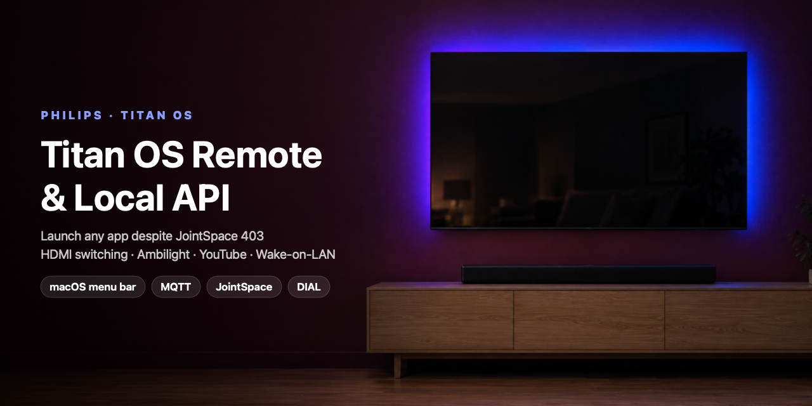

# Philips Titan OS Remote & API — macOS menu bar app (55PML9019 / PML9019)



**Control a Philips Titan OS TV from your Mac** — launch any app (Netflix, Disney+, HBO Max,
YouTube, Prime Video…), switch HDMI sources, turn Ambilight on/off, control YouTube playback,
wake the TV with Wake-on-LAN, and drive an **Orange TV box** — all over the local network.

Also a **developer reference for the Philips Titan OS local API**: Titan OS blocks the
classic JointSpace app/source endpoints (`403 Forbidden`), so this project documents the
channels that *do* work — the **Titan OS MQTT** protocol (reverse-engineered from the official
Titan OS Mobile app), JointSpace v6, DIAL and the YouTube Lounge API.
👉 **[docs/TITAN_OS_API.md](docs/TITAN_OS_API.md)**

> Tested on a **Philips 55PML9019/12 "The Xtra"** (Titan OS, JointSpace 6.1, firmware
> 248.010.000.121, Poland) with an **Orange Polska** Sagemcom decoder on HDMI 1 and a
> **Philips TAB6309** soundbar on HDMI 2 (eARC). Other Philips Titan OS TVs (2024+) should
> behave the same — reports welcome.

## Features

| Tab | What it does |
|---|---|
| 🏠 **Home** | Live **"now on"** (home screen / app / HDMI / Orange channel), **YouTube now-playing** card with play/pause/seek/next, soundbar volume, favourite apps (Home always first), quick sources |
| 🎮 **Remote** | D-pad, OK/Home/Back/Menu/Info, media keys, channel ±, pointer trackpad, keyboard |
| ▦ **Apps** | Every app installed on the TV (icons, search, ★ favourites) — one click launches it |
| ⌁ **Sources** | HDMI 1–4, Satellite, Antenna, Streaming, USB, Network |
| 📦 **Orange TV** | *Optional* — only shown when an Orange decoder is found on the network (SSDP). Power, d-pad, channels, digits |
| ✨ **Ambilight** | Follow video / follow audio / colour presets, and a **working Off** on Titan OS |
| ⚙️ **Settings** | Connection status, pairing, refresh |

- **Power:** wakes the TV with **Wake-on-LAN** from deep standby; the Orange box's power
  button turns the TV on/off with it over HDMI-CEC.
- English UI, dark theme, lives in the macOS menu bar.

## FAQ — Philips Titan OS

**Why does `/6/applications` return 403 on my Philips Titan OS TV?**
Titan OS locks down JointSpace's app and source endpoints (`/6/applications`, `/6/sources`,
`/6/activities/launch`). Launch apps through the Titan OS MQTT `deeplink` topic instead →
[docs](docs/TITAN_OS_API.md#launch-an-app).

**How do I launch Netflix / Disney+ / HBO Max / YouTube on a Titan OS TV programmatically?**
Pair with the TV's MQTT server on port 8883 (4-digit PIN) and publish
`deeplink {"app_code":"disney","url":"disneyplus"}`. YouTube, Netflix and Prime also work
via DIAL on port 56789 with the right `Origin` header.

**How do I turn Ambilight off via the API on Titan OS?**
`ambilight/power Off` is ignored. Set the settings node "Ambilight style" (300) to 310 with
`POST /6/menuitems/settings/update` → [docs](docs/TITAN_OS_API.md#turning-ambilight-off-the-only-way-that-works-on-titan-os).

**How do I switch HDMI input on a Philips Titan OS TV?**
There's no source API; walk the Sources drawer with MQTT `rc` keys → [docs](docs/TITAN_OS_API.md#selecting-hdmi--sources).

**Why does `powerstate` say "On" when the TV is off?**
Titan keeps JointSpace running in quick standby; in deep standby the TV leaves the network.
Use reachability + Wake-on-LAN.

**Does it work with Home Assistant?**
This is a standalone Mac app, but the protocol notes apply directly to Home Assistant's
`philips_js` / ha-philipsjs and to openHAB/Homey bindings.

**Spotify on Titan OS?**
Not in the Titan catalog yet (expected late 2026). The TV has a DTS Play-Fi receiver.

## How it works — the control channels

| Channel | Used for |
|---|---|
| **Titan OS MQTT** `mqtts://<tv>:8883` | launch any app, remote keys, keyboard, installed-app list, home-screen state, source macro |
| **JointSpace v6** `https://<tv>:1926/6/` | Ambilight (via settings menu nodes), pointer, context, power state |
| **DIAL** `http://<tv>:56789/apps/` | YouTube/Netflix/Prime launch without pairing, app running state |
| **YouTube Lounge API** | now playing, play/pause/seek/next on the TV's YouTube app |
| **Wake-on-LAN** | power on from deep standby |
| **Orange decoder** `http://<box>:8080/remoteControl/cmd` | optional, auto-discovered via SSDP (`X_OrangeSTBRemoteControl`): status, keys, tune by number (same API as Orange France Livebox) |

Full protocol details, payloads, key codes and gotchas: **[docs/TITAN_OS_API.md](docs/TITAN_OS_API.md)**.

## Known issue: JointSpace instability on Titan OS

On the 55PML9019 (firmware 248.010.000.121) the TV's JointSpace HTTPS server is fragile:

- **Wedges under bursts of requests** — e.g. a large list dump (`/6/channeldb/tv/channelLists/all`) or many
  calls in quick succession. The port stays open but TLS handshakes time out.
- **Answers `404` to every path** (even `/6/system`, any API version) — seen after a day of heavy testing and
  a Wake-on-LAN wake. Titan MQTT, DIAL and the YouTube Lounge keep working.
- In both cases **only a power cut** (unplugging) restores it — remote power, long-press power and a full
  deep-standby + Wake-on-LAN cycle did not. Other Home Assistant users report the same
  ([home-assistant/core#156776](https://github.com/home-assistant/core/issues/156776)).

How the app avoids triggering it (since v0.2):

- Every JointSpace request goes through a **gate**: one request at a time, ≥0.7 s apart.
- The Digest challenge is **reused**, so each call is one round trip instead of two.
- **No routine JointSpace polling**: power state, model and "now on" come from Titan MQTT; JointSpace gets one
  light health probe every 2 minutes, and `context` is read at most every 30 s.
- Trackpad pointer moves are **coalesced** into one request at a time.
- List-dumping endpoints are never called.

What still needs JointSpace: **Ambilight** and the **pointer**. Everything else (apps, remote keys, sources,
YouTube, Orange box, Wake-on-LAN) works without it. When JointSpace is down the footer says so.

## Install (macOS app)

```bash
git clone https://github.com/bedirhanyildirim/philips-titan-os-55pml9019-remote.git
cd philips-titan-os-55pml9019-remote/app
./make-signing-cert.sh      # once — stable identity so the Local Network permission sticks
./build.sh
open dist/PhilipsTVMenubar.app
```

Requires macOS 13+ and the Xcode Command Line Tools. On first launch:

1. Allow **Local Network** access (System Settings → Privacy & Security → Local Network).
2. Pair the remote: enter the TV's IP, then the PIN shown on the TV.
3. Pair Titan OS (Apps tab → *Unlock all apps*): enter the second PIN.

Credentials live in `~/.philips-tv-remote/` (mode 600) and are never committed.
To start at login: System Settings → General → Login Items.

## Python reference client

```bash
python3 -m pip install -r requirements.txt
python3 pair.py 192.168.0.45          # JointSpace pairing
python3 titan_pair.py 192.168.0.45    # Titan OS MQTT pairing
python3 titan_pair.py --apps          # list installed apps
python3 titan_pair.py --launch disney # launch one
```

## Project layout

```
philips-titan-os-55pml9019-remote/
├── app/Sources/PhilipsTVMenubar/     # SwiftUI menu bar app
│   ├── TitanClient.swift             # Titan OS MQTT v5 client (Network.framework, no deps)
│   ├── PhilipsClient.swift           # JointSpace v6 (manual Digest auth), Ambilight, DIAL
│   ├── YouTubeLounge.swift           # YouTube Lounge API client
│   ├── OrangeClient.swift            # Orange TV box HTTP API
│   ├── WakeOnLAN.swift               # magic packet
│   ├── AppState.swift                # state, polling, "now on", source macro
│   └── *Tab.swift, AmbilightView, YouTubeCard, Theme, PhilipsTVApp
├── philipstv/                        # Python: client.py (JointSpace), titan.py (MQTT), orange.py
├── docs/TITAN_OS_API.md              # protocol reference
├── dns/                              # DNS blocking for Titan Ads
└── ROADMAP.md                        # status, findings, next steps
```

## Credits / references

- [ha-philipsjs](https://github.com/danielperna84/ha-philipsjs) — JointSpace pairing/signature
- [Home Assistant core #156776](https://github.com/home-assistant/core/issues/156776) — Ambilight off on Titan OS
- [pylips](https://github.com/eslavnov/pylips) — JointSpace command reference
- Titan OS Mobile app — MQTT protocol (reverse-engineered for interoperability)
- [LGwebOS-menubar](https://github.com/gabrielgreco1/LGwebOS-menubar) — UI inspiration

Not affiliated with Philips, TP Vision, Titan OS, Orange or Google.

## License

MIT
